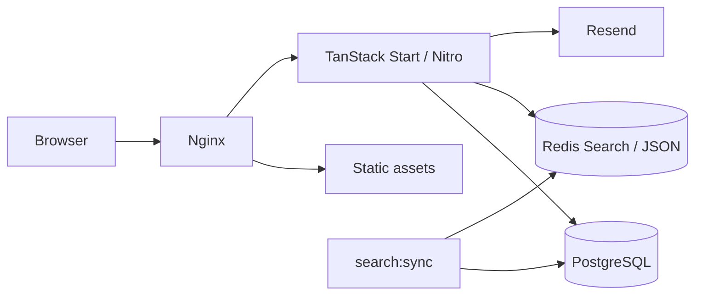
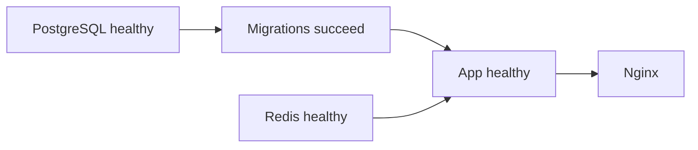

# 2o

A Georgian and English storefront for browsing wholesale clothing and footwear, comparing deals, and saving products to a cart. Includes catalog search and filters, email/password sign-in, email-code verification and password reset, optional social sign-in, and an address book. Georgian is the default language.

**Status:** browsing, accounts, addresses, carts, and bank-transfer checkout are implemented. Checkout supports U.S. delivery, frozen USD/GEL totals, private receipt uploads, and pending orders. Payment verification and fulfillment remain manual. See [Checkout setup](docs/checkout.md) and [Known limitations](#known-limitations).

## Contents

- [Quick start](#quick-start)
- [Stack](#stack)
- [Architecture](#architecture)
- [Features](#features)
- [UI and localization](#ui-and-localization)
- [Development](#development)
- [Configuration](#configuration)
- [Commands](#commands)
- [Production](#production)
- [Repository layout](#repository-layout)
- [Testing](#testing)
- [Extending](#extending)
- [Troubleshooting](#troubleshooting)
- [Known limitations](#known-limitations)

## Quick start

Requires Docker with the Compose plugin. The dev stack runs the app, PostgreSQL, Redis, and Nginx; host Node.js and pnpm are optional.
1. Create `.env.development` in the repo root (see [Configuration](#configuration)). Set DB credentials and `BETTER_AUTH_SECRET` (`openssl rand -hex 32`). Env files are git- and Docker-ignored; no examples are included.
2. Start the stack:

   ```sh
   docker compose --env-file .env.development -f docker-compose.dev.yaml up --build
   ```

3. Open **http://localhost:3000**. Migrations run before the app starts; Nginx proxies requests and hot-reload WebSockets to Vite. Dev uses plain HTTP and no database TLS, so no certificates are needed.
4. Optionally seed the catalog:

   ```sh
   docker compose --env-file .env.development -f docker-compose.dev.yaml exec app pnpm db:seed
   ```

   Seeding creates sample products and SKUs, then tries to refresh the search index and stats. Re-running replaces products under the reserved `.example` warehouse domains. It refuses to run with `NODE_ENV=production`.

Without a Resend key, dev emails and verification codes appear in the app logs:

```sh
docker compose --env-file .env.development -f docker-compose.dev.yaml logs -f app
```

**SELinux hosts (Fedora, RHEL):** bind mounts in the Compose files use `:z` / `selinux: z` so containers can read them. Without it you get `Permission denied` on project files.

## Stack

Exact ranges are in `package.json`; resolved versions in `pnpm-lock.yaml`. Always install with the frozen lockfile.

| Layer         | Technology                                                   |
| ------------- | ------------------------------------------------------------ |
| Runtime       | Node.js 26, pnpm 12, TypeScript 7                            |
| App           | React 19, TanStack Start/Router/Query/Form/Store, Zod 4      |
| UI            | Tailwind CSS 4, Base UI, copied shadcn components, Hugeicons |
| Auth          | Better Auth, Better Auth UI                                  |
| Data          | PostgreSQL 18, Drizzle ORM/Kit 1.0 RC                        |
| Search/cache  | Redis 8 with Search and JSON                                 |
| Email         | Resend                                                       |
| Build/hosting | Vite 8, Nitro 3 beta, Docker Compose, Nginx                  |
| Quality       | Biome, Vitest, Knip, TypeScript diagnostics                  |

Drizzle and Nitro are pinned prereleases: review migration notes and run the full validation pipeline when changing them.

## Architecture

A single full-stack service organized by feature. PostgreSQL is the source of truth; Redis holds derived catalog documents and transient state.



In dev, Nginx forwards everything to Vite. In production it serves built assets directly and proxies the rest to Node. The runtime image runs as the non-root `node` user; migrations run in a separate one-shot service.

### Conventions

| Location                          | Responsibility                                                              |
| --------------------------------- | --------------------------------------------------------------------------- |
| `src/routes/`                     | Route params, validated search, loaders, metadata, HTTP endpoints.          |
| `src/features/<feature>/`         | Business logic, components, query options, schemas, mutations.              |
| `*.functions.ts`                  | Browser-callable server functions: validate input, enforce access.          |
| `*.server.ts`                     | Server-only code (DB, Redis, email, secrets). Still validate and authorize. |
| `*.queries.ts` / `*.mutations.ts` | Cache keys, query options, mutation coordination.                           |
| `src/components/`                 | Shared layout, forms, auth views, home sections, UI primitives.             |
| `src/data/`, `src/i18n/`          | Site config, catalog taxonomy, types, messages.                             |

Route loaders run on both server and client, so they are **not** a server-only boundary. Keep private work behind server functions.

### Request lifecycle

1. `src/router.tsx` creates a router and a per-request QueryClient (no shared module-level client holding user data).
2. The root route resolves locale from a cookie and loads public config.
3. Loaders fill Query's cache via shared query options; SSR hydrates it in the browser.
4. Navigation validates search input, preloads on intent, and restores scroll.
5. Mutations call server functions, then update or invalidate affected queries.

### State ownership

| State                                     | Owner                |
| ----------------------------------------- | -------------------- |
| Catalog search, filters, sort, SKU choice | Validated URL search |
| Products, facets, stats, cart, addresses  | TanStack Query       |
| Form values and validation                | TanStack Form        |
| Debounce text, slider drafts, popovers    | Component state      |
| Cart drawer open/closed                   | TanStack Store       |
| Locale and visitor cart identity          | HTTP-only cookies    |

### Routes

| URL                         | Purpose                                                         |
| --------------------------- | --------------------------------------------------------------- |
| `/`                         | Hero, featured deals, department tiles, closing CTA.            |
| `/deals`                    | Searchable, filterable discounted products.                     |
| `/about`                    | Store selection story and interactive 3D process illustration.  |
| `/$department/{-$category}` | Department listing, optional category (`/women/shoes`).         |
| `/product/$slug`            | Product details and SKU selection.                              |
| `/auth/$path`               | Better Auth UI views (sign-in, verification, ...).              |
| `/settings/$path`           | Account and security settings, saved addresses.                 |
| `/checkout`                 | Resumable bank-transfer checkout and confirmation, not indexed. |
| `/api/auth/*`               | Better Auth handler.                                            |
| `/api/health`               | Liveness only; does not check PostgreSQL or Redis.              |
| `/sitemap.xml`              | Public pages (including About) and products with available SKUs. |

`src/routeTree.gen.ts` is generated by the Vite integration. Don't edit it.

## Features

### About and footer navigation

`/about` explains the selection process: choose reputable U.S. stores, filter and compare listings, and bring the results together for customers. The page has a brand-black introduction, a light process section, and a closing explanation of recorded prices and availability.

- Three selectable steps highlight layers in a CSS 3D illustration; no WebGL or graphics-library dependency. All step descriptions remain visible, with keyboard-operable buttons, an announced selection summary, and reduced-motion support.
- The footer links to **About us** under **Discover** (Georgian: **ჩვენ შესახებ** under **გაგვიცანით**).
- Page copy and metadata support English and Georgian; `/about` is included in the sitemap.
- The page describes the service, not an ingestion implementation in this repository. It makes no claim of live AI selection or guaranteed lowest prices.

### Catalog and search

`src/data/catalog.ts` defines the department/category taxonomy. Products hold identity and descriptions; SKUs hold color, size, image, price, original price, and stock. Money is stored as integer minor units (tetri) plus a currency code.

In-stock SKUs are transformed into Redis JSON documents. Department listings show each product's cheapest SKU; Deals shows the deepest-discounted one. Search supports text, brand, size, color, price range, sale status, and sorting, in pages of up to 48 with automatic and manual load-more.
- The index name includes a hash of its schema. First catalog access creates the index and syncs if it is new or empty (memoized per process). This is **not** a scheduled import.
- Run `pnpm search:sync` after catalog changes; it also removes indexed products missing from PostgreSQL.
- `search:sync` does not refresh stats. Importers must also call `refreshStats()` from `src/features/stats/stats.server.ts`.
- Client freshness: 1 min for results/facets, 5 min for stats. Stats also have a 1-day Redis cache that falls back to PostgreSQL.
- Search needs Redis Search and JSON and has no PostgreSQL fallback.
- The warehouse importer and scheduler are not in this repo; the storefront shows actual recorded price-check times.

### Cart

- The cart belongs to a visitor's `cartId` cookie, not an account, and is not merged on sign-in.
- Redis stores SKU IDs and quantities at `cart:<id>` with a 30-day expiry. Prices and availability are re-read from PostgreSQL on every fetch; unavailable SKUs are omitted.
- Limits: 50 lines, 10 units per SKU, one currency.
- Client writes share a mutation scope (serialized per client) and refresh after the last queued write.
- Redis scripts enforce limits and quantity changes atomically across clients. Adds revalidate catalog currency when SKU membership changes, retrying up to eight times before asking the customer to retry.
- Quantity updates cannot recreate removed lines. Checkout subtracts purchased quantities atomically, preserving concurrent additions. Catalog reads and Redis writes are separate; checkout validates its own quote.

### Checkout

- Signed-in customers select a U.S. address, review a server-created quote, transfer either the USD or GEL total, and upload a receipt before placing an order.
- The server owns prices, fees, and the exchange rate. Quotes last 24 hours; retries retain their original amounts.
- Orders and notification jobs commit together. The separate worker forwards order details and receipts to the configured Telegram chat; payment verification remains manual.
- See [docs/checkout.md](docs/checkout.md) for required settings, worker deployment, pricing rules, and operational limits.

### Authentication and addresses

- Better Auth lives under `/api/auth`, using PostgreSQL (Drizzle relations-v2 adapter) plus Redis secondary storage and rate limiting.
- Email/password accounts require verification; email codes cover verification and password reset. Codes are stored hashed; resets revoke sessions.
- Google and Facebook appear only when both credentials are configured.
- Resend sends email in production; dev without a key logs it instead.
- Address functions resolve the user from request headers and scope every operation to that owner. Max 10 addresses; mutations lock the owner row, and a partial unique index allows one primary. Removing the primary promotes the oldest remaining address.

### Persistence

| Storage                                             | Data                                                       |
| --------------------------------------------------- | ---------------------------------------------------------- |
| PostgreSQL `product`, `skus`                        | Catalog, prices, images, availability.                     |
| PostgreSQL auth tables                              | Users, accounts, sessions, verification.                   |
| PostgreSQL `address`                                | Owned addresses, primary selection.                        |
| PostgreSQL `orders`, `order_item`                   | Pending orders and immutable purchased-item snapshots.     |
| PostgreSQL `checkout_session`, `order_notification` | Private quotes, receipts, and durable notification jobs.   |
| Redis                                               | Search docs/indexes, carts, stats, auth secondary storage. |

Schema: `src/db/schema.ts`, `src/db/auth-schema.ts`; migrations in `drizzle/`. Redis is not fully disposable: catalog documents rebuild, but wiping it also discards carts and auth secondary state.

## UI and localization

**Design.** `src/styles.css` owns color, type, radius, and motion tokens: charcoal surfaces, yellow accent `#ffc800`, light content areas, and a separate `link` token for readable links. No theme switch. Fonts (Figtree, Archivo, Noto Sans Georgian) are bundled via Fontsource.

| Utility           | Use                                  |
| ----------------- | ------------------------------------ |
| `type-display`    | Large promotional headlines.         |
| `type-title`      | Page and section headings.           |
| `type-card-title` | Product and card titles.             |
| `type-body`       | Descriptive copy.                    |
| `type-caption`    | Small supporting text.               |
| `type-eyebrow`    | Short category/brand/section labels. |
| `type-num`        | Prices, counts, numbers.             |

**Composition.** Use `Container`, `Section` (`src/components/layout/container.tsx`) and `SectionHeader` for layout. Reuse primitives in `src/components/ui/`; combine classes with `cn()`, define variants with class-variance-authority, and use Hugeicons. Product cards have one primary link; images reserve space and show a translated fallback.

**Responsive and accessible.** Check both languages from 320px up; Georgian strings run long, so let flex/grid children shrink and avoid fixed widths. The shell has a skip link and main landmark; keep labels, visible focus, pending/disabled states, status announcements, and reduced-motion support intact. Test loading, empty, error, and success states.

**Localization.** `ka` (default) and `en`. The server reads the HTTP-only `2o-locale` cookie before rendering; the language selector saves via a server function and invalidates route data.
- `src/i18n/storefront-ka.ts` maps English source strings to Georgian. Use `useTranslation()` in components and `translate()` (explicit locale) elsewhere.
- `en.ts` / `ka.ts` hold typed messages for forms and custom auth flows; `auth-ka.ts` holds Better Auth UI's Georgian copy.
- Prices format by locale and currency; price-check times use `Asia/Tbilisi`.
- Write Georgian as natural customer-facing copy rather than translating English slogans word for word. Keep the meaning and service claims consistent across languages.
- Preserve `{{placeholder}}` names. Missing translations fall back to the source string; product names are not translated. Keep locale in providers, never module-level globals.

## Development

There is no default Compose file; always pass `-f`.

```sh
# Status
docker compose --env-file .env.development -f docker-compose.dev.yaml ps
# Run checks in the app container
docker compose --env-file .env.development -f docker-compose.dev.yaml exec app pnpm verify
# Rebuild after dependency, Dockerfile, or migration changes
docker compose --env-file .env.development -f docker-compose.dev.yaml up --build
# Stop, keeping volumes
docker compose --env-file .env.development -f docker-compose.dev.yaml down
```

Dev project is `2o-dev`, production is `2o`; their volumes are separate. `down --volumes` deletes that stack's data.

Host development: Node.js 26, pnpm 12.14.0, `pnpm install --frozen-lockfile`, plus your own reachable PostgreSQL and Redis before `pnpm db:migrate` and `pnpm dev`. Compose does **not** publish DB or Redis ports.

## Configuration

Dev loads `.env.development`, production `.env.production`. These are real, untracked files; get values separately on a new machine. Pass `--env-file` to Compose so credential interpolation matches the app. Package DB/maintenance commands use Node's `--env-file-if-exists`, default to development, and honor existing process env; use `NODE_ENV=production pnpm db:migrate` to target production. Validation lives in `src/server/env.server.ts` and `src/db/connection.ts`.

| Variable                                       | Purpose                                                                               |
| ---------------------------------------------- | ------------------------------------------------------------------------------------- |
| `DB_USER`, `DB_PASSWORD`, `DB_NAME`            | Required by both stacks; initialize PostgreSQL and connect the app.                   |
| `DB_HOST`, `DB_PORT`                           | Default `localhost:5432`; Compose sets `db:5432`.                                     |
| `DB_SSL`                                       | Default `false`; Compose sets `false` in dev, `true` in production.                   |
| `DB_SSL_SERVERNAME`                            | Required in production; hostname verified against the DB certificate.                 |
| `REDIS_HOST`, `REDIS_PORT`                     | Default `localhost:6379`; Compose sets `redis:6379`.                                  |
| `BETTER_AUTH_SECRET`                           | Required, at least 32 characters.                                                     |
| `BETTER_AUTH_URL`                              | Auth origin. Dev Compose: `http://localhost:3000`; production: your public HTTPS URL. |
| `SITE_URL`                                     | Public origin for the sitemap; falls back to `BETTER_AUTH_URL`.                       |
| `RESEND_API_KEY`                               | Required in production; if absent in dev, emails are logged.                          |
| `EMAIL_FROM`                                   | Sender; defaults to `2o <onboarding@resend.dev>`. Set your own for production.        |
| `GOOGLE_CLIENT_ID`, `GOOGLE_CLIENT_SECRET`     | Optional Google sign-in; set both or neither.                                         |
| `FACEBOOK_CLIENT_ID`, `FACEBOOK_CLIENT_SECRET` | Optional Facebook sign-in; set both or neither.                                       |
| `CHAT_EMBED_URL`                               | Optional Tawk.to embed; widget hidden when unset.                                     |

Compose's explicit `environment` values override env-file values. Changing PostgreSQL credentials does not update an existing volume's users or passwords.

## Commands

Run with `pnpm` on the host, or prefix with `docker compose --env-file .env.development -f docker-compose.dev.yaml exec app pnpm`.

| Command                  | Purpose                                                                       |
| ------------------------ | ----------------------------------------------------------------------------- |
| `dev`                    | Start Vite on port 3000.                                                      |
| `build` / `preview`      | Build into `.output` / preview the build.                                     |
| `check` / `fix`          | Check formatting and lint / apply automatic fixes.                            |
| `check:deprecations`     | Reject compiler-marked deprecated APIs in project code.                       |
| `typecheck`              | Check TypeScript types.                                                       |
| `test`                   | Run Vitest.                                                                   |
| `verify`                 | Biome CI checks, TypeScript, and tests.                                       |
| `knip`                   | Find unused files, exports, and dependencies.                                 |
| `db:generate`            | Generate a migration from schema changes.                                     |
| `db:migrate`             | Apply pending migrations.                                                     |
| `db:push`                | Apply the schema directly, without a migration file.                          |
| `db:studio`              | Open Drizzle Studio.                                                          |
| `db:seed`                | Populate sample development catalog data.                                     |
| `checkout:notifications` | Deliver queued order notifications and clean expired drafts without evidence. |
| `search:sync`            | Rebuild the Redis catalog index from PostgreSQL.                              |
| `search:check`           | Check Redis Search and JSON support using a temporary test index.             |

Redis needs the Search and JSON modules; Compose uses `redis:8.10.2-alpine`.

## Production

The production stack builds the app, runs migrations, and serves it through Nginx. Port 80 redirects to HTTPS on 443; Nginx serves built assets directly and proxies the rest to Node.

**Before starting**
1. Configure `.env.production`: DB credentials, a distinct `BETTER_AUTH_SECRET`, `RESEND_API_KEY`, `EMAIL_FROM`.
2. Set `BETTER_AUTH_URL` and `SITE_URL` to your public HTTPS origin.
3. Provide `certs/fullchain.pem` and `certs/privkey.pem` (real files, not symlinks). They are mounted into both Nginx and PostgreSQL.
4. Set `DB_SSL_SERVERNAME` to a hostname the certificate covers. DB connections verify both trust and hostname.

**Certificate permissions.** PostgreSQL refuses a private key that is group/world-accessible or not owned by its user. You can fix this on the host without copying the key:

```sh
sudo chown root:70 certs/privkey.pem   # uid/gid 70 = postgres in the Alpine image
sudo chmod 640 certs/privkey.pem       # root-owned keys may be 0640
chmod 644 certs/fullchain.pem
```

Alternative: `chown 70:70` with `chmod 600`. Nginx's master process runs as root and reads either. If certbot renews the files, re-apply ownership in a deploy hook. With rootless Docker/Podman, uid mapping differs; copy the key inside the container instead.

**Startup order**



These are startup gates only; the liveness endpoint does not recheck the database afterwards.

```sh
# Validate config without printing secrets
docker compose --env-file .env.production -f docker-compose.prod.yaml config --quiet
# Build and start / deploy updated code
docker compose --env-file .env.production -f docker-compose.prod.yaml up -d --build
# Inspect status and logs
docker compose --env-file .env.production -f docker-compose.prod.yaml ps -a
docker compose --env-file .env.production -f docker-compose.prod.yaml logs --tail=100 migrate app web
# Stop, keeping data
docker compose --env-file .env.production -f docker-compose.prod.yaml down
```

The runtime image contains only the built app. Run source-based scripts through the `migrate` service, which keeps the source and tooling:

```sh
docker compose --env-file .env.production -f docker-compose.prod.yaml run --rm migrate pnpm search:sync
```

## Repository layout

| Path                                    | Contents                                       |
| --------------------------------------- | ---------------------------------------------- |
| `src/routes/`                           | File-based routes, loaders, server endpoints.  |
| `src/features/`                         | Catalog, search, cart, auth, addresses, stats. |
| `src/components/`                       | Shared UI, forms, layout, homepage.            |
| `src/i18n/`                             | Messages, locale state, persistence.           |
| `src/data/`                             | Taxonomy, types, sizes, site info.             |
| `src/db/`, `drizzle/`                   | Connection, schema, migration history.         |
| `src/server/`                           | Env validation, Redis client, cache helpers.   |
| `scripts/`                              | Seeding, search sync, integration checks.      |
| `docker-compose.*.yaml`, `nginx.*.conf` | Per-environment service and proxy config.      |
| `vite.config.ts`, `vitest.config.ts`    | Separate app build and unit-test configs.      |
| `.github/workflows/ci.yml`              | CI checks and Redis Search integration check.  |
| `docs/`                                 | Checkout setup and operational details.        |

## Testing

Run the CI checks before proposing a substantial change:

```sh
pnpm verify && pnpm check:deprecations && pnpm knip && pnpm build && pnpm search:check
```

`verify` covers Biome, TypeScript, and unit tests. `search:check` needs Redis with Search and JSON (use the container prefix under Compose).

Tests live beside source as `*.test.ts(x)`, run under a separate Node-based Vitest config so Start/Nitro RPC transforms don't bypass mocked server boundaries. `check:deprecations` reads TypeScript's suggestion diagnostics; it is not a vulnerability scanner and depends on the installed TypeScript version.

CI runs on pushes to `main` and pull requests with a Redis service. It does not provision PostgreSQL or run browser end-to-end tests. For UI work, also check both languages at mobile/tablet/desktop widths, keyboard use, dialog dismissal, and loading/empty/error states. Verify auth, authorization, persistence, and concurrency against real services.

## Extending

### Add a feature or route

1. Put feature logic in `src/features/<feature>/`; shared primitives in `src/components/`.
2. Validate untrusted server-function input with `.validator()`; enforce ownership in the handler.
3. Implement in `*.server.ts`, expose through `*.functions.ts`. Keep secrets out of browser config and props.
4. Define keys and options in `*.queries.ts`; use `.query()` / `.infiniteQuery()` in loaders and forward abort signals.
5. Add the route with validated params/search, metadata, and pending/error/empty states. Let the route tree regenerate.
6. Use `useServerFn` for mutations and refresh affected queries after writes.
7. Add copy in both languages and regression tests.

### Change the database or catalog

```sh
pnpm db:generate   # after editing the Drizzle schema; review SQL and snapshot
pnpm db:migrate    # apply to the selected dev database
pnpm search:sync   # refresh derived search data
```

Commit schema changes with their migration files. Use `db:push` only on disposable databases, and review renames and destructive operations first.

New departments or categories change the PostgreSQL enums: update `src/data/catalog.ts`, the migration, labels/translations, navigation, and `department-tiles.tsx` (visual tone). Changes to search fields also require updating the document builder, field definitions, queries, and tests.

### Change brand content

Edit `src/data/site.ts` (brand copy, currency, time zone, delivery display) and `src/data/socials.ts`; adjust tokens in `src/styles.css`. Keep `src/i18n/` in sync and don't present unimplemented services as available actions.

The About story and process steps live in `src/routes/about.tsx`, with scene styles in `src/styles.css`. Footer links live in `src/components/layout/footer.tsx`; Georgian storefront copy lives in `src/i18n/storefront-ka.ts`. Update page metadata and translations when changing the story, and retain keyboard and reduced-motion behavior when adjusting the illustration.

## Troubleshooting

| Symptom                                                | Check                                                                                    |
| ------------------------------------------------------ | ---------------------------------------------------------------------------------------- |
| Compose reports missing variables                      | Set matching `--env-file` / `-f` values; see [Configuration](#configuration).            |
| App won't start or Nginx returns 502                   | `... ps -a`, then check `migrate`, `app`, `web` logs. A failed migration blocks the app. |
| `Permission denied` on mounted files (Fedora/RHEL)     | Keep SELinux bind-mount labels; inspect denials with `sudo ausearch -m avc -ts recent`.  |
| `db` fails with private-key ownership/permission error | See [Certificate permissions](#production).                                              |
| Production database TLS fails                          | Check certificate trust, file access, and the `DB_SSL_SERVERNAME` match.                 |
| Host commands can't reach PostgreSQL or Redis          | Ports aren't published. Run commands in the app container or provide separate services.  |
| Catalog is empty                                       | Ensure PostgreSQL has products with in-stock SKUs (seed dev only), then `search:sync`.   |
| Unknown `FT.*` or `JSON.*` command                     | Redis lacks the modules. Use the configured image and run `search:check`.                |
| Stale products or prices                               | Run `search:sync`, wait out the client cache; refresh stats separately.                  |
| Verification email missing                             | Dev without Resend: check app logs. Production: check the Resend key and sender.         |
| Social sign-in missing                                 | Set both ID and secret, callback settings, and the correct public auth origin.           |
| New route not recognized                               | Run the Vite dev/build flow to regenerate `src/routeTree.gen.ts`, then typecheck.        |
| Unit tests start Nitro or generate RPC calls           | Make sure Vitest loads `vitest.config.ts`; don't merge app server plugins into it.       |

`/api/health` is liveness only: it shows the process answers HTTP, not that search, PostgreSQL, email, or checkout work.

## Known limitations

- **Payment and fulfillment:** bank transfers are verified manually. There is no card processor, sales-tax engine, stock reservation, fulfillment integration, or order-management dashboard. Shipping is limited to U.S. addresses.
- **Catalog ingestion:** only sample seeding and index sync exist; no warehouse importer or scheduled price refresh.
- **Operational durability:** no automated backups, restore drills, or high availability. Redis loss also affects carts and auth secondary state.
- **Verification scope:** CI has unit tests and a Redis Search check, but no automated cart integration tests, PostgreSQL/auth/browser end-to-end suite, or formal accessibility certification.
