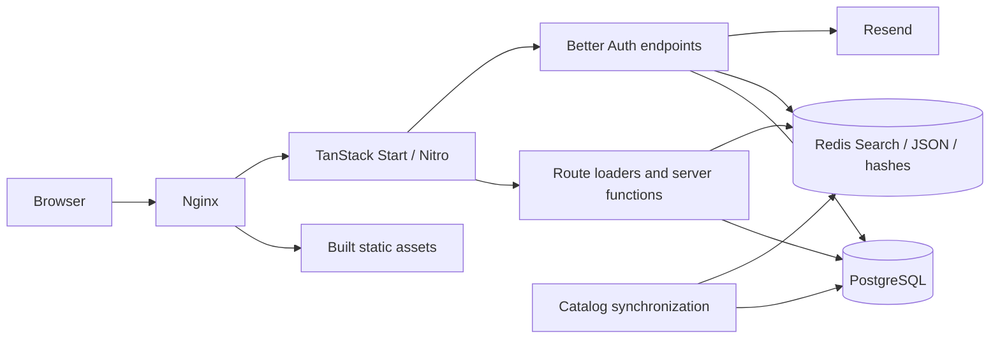

# 2o

A Georgian and English storefront for browsing wholesale clothing and footwear,
comparing deals, and saving products to a cart. Includes catalog search and
filters, email/password sign-in, email-code verification and password reset,
optional social sign-in, and an address book. Georgian is the default language.

Built with React 19, TanStack Start and Router, TypeScript, Tailwind CSS, Better
Auth, and Drizzle ORM. PostgreSQL stores application data; Redis provides catalog
search and caching. Nginx handles the public HTTP/HTTPS endpoint.

**Project status:** browsing, accounts, addresses, and carts are implemented.
Checkout is a placeholder; payments and order fulfillment are not implemented.
See [known limitations](#known-limitations) before treating this as a complete
commerce application.

## Contents

- [Quick start](#quick-start)
- [Technology stack](#technology-stack)
- [Architecture](#architecture)
- [Features and data flows](#features-and-data-flows)
- [UI and design system](#ui-and-design-system)
- [Localization](#localization)
- [Everyday development](#everyday-development)
- [Configuration](#configuration)
- [Commands](#commands)
- [Production](#production)
- [Repository layout](#repository-layout)
- [Testing and quality checks](#testing-and-quality-checks)
- [Extending the application](#extending-the-application)
- [Troubleshooting](#troubleshooting)
- [Known limitations](#known-limitations)

## Quick start

Install Docker with the Compose plugin. The development stack includes the app,
PostgreSQL, Redis, and Nginx; host Node.js and pnpm installations are optional.

Copy the development template and set your database password and auth secret:

```sh
cp .env.development.example .env.development
```

Generate your own authentication secret with `openssl rand -hex 32`. Both
`.env.development` and `.env.production` are ignored by Git and Docker builds.

Start the stack:

```sh
docker compose --env-file .env.development -f docker-compose.dev.yaml up --build
```

Open **http://localhost:3000**. Database migrations run before the app starts.
Nginx forwards requests and hot-reload WebSockets to Vite. Source files are
bind-mounted; container dependencies live in their own volume. Development uses
HTTP and disables database TLS, so certificates are unnecessary.

In another terminal, optionally populate the catalog:

```sh
docker compose --env-file .env.development -f docker-compose.dev.yaml exec app pnpm db:seed
```

The seed script creates sample products and SKUs, then attempts to refresh the
search index and statistics. Re-running it replaces products under the reserved
`.example` warehouse domains. It refuses to run with `NODE_ENV=production`.

Without a Resend API key, development emails and verification codes appear in
application logs:

```sh
docker compose --env-file .env.development -f docker-compose.dev.yaml logs -f app
```

## Technology stack

The versions below describe the repository's current major versions. Exact
dependency ranges live in [package.json](package.json); resolved versions live in
[pnpm-lock.yaml](pnpm-lock.yaml). Install with the frozen lockfile for reproducible
builds.

| Layer                        | Technology                                                   | Role                                                                      |
| ---------------------------- | ------------------------------------------------------------ | ------------------------------------------------------------------------- |
| Runtime and packages         | Node.js 26, pnpm 12                                          | Application server, tooling, dependency management.                       |
| Language                     | TypeScript 7                                                 | Strict types, including unchecked-index access checks.                    |
| Rendering and routing        | React 19, TanStack Start and Router                          | Server rendering, typed file routes, server functions, navigation.        |
| Server state                 | TanStack Query 5                                             | Shared query options, hydration, caching, mutations, pagination.          |
| Forms and local state        | TanStack Form, TanStack Store, Zod 4                         | Form state, cart drawer visibility, input validation.                     |
| UI                           | Tailwind CSS 4, Base UI, copied shadcn components, Hugeicons | Design tokens, accessible interaction primitives, shared controls, icons. |
| Authentication               | Better Auth, Better Auth UI                                  | Accounts, sessions, verification, social sign-in, account settings.       |
| Database                     | PostgreSQL 18, Drizzle ORM/Kit 1.0 RC                        | Relational data, typed queries, versioned SQL migrations.                 |
| Search and transient storage | Redis 8 with Search and JSON                                 | Catalog index, carts, statistics cache, auth secondary storage.           |
| Email                        | Resend                                                       | Verification, password-reset, and email-change messages.                  |
| Build and hosting            | Vite 8, Nitro 3 beta, Docker Compose, Nginx                  | Client/server builds, Node runtime output, service orchestration, HTTPS.  |
| Quality                      | Biome, Vitest, Knip, TypeScript diagnostics                  | Formatting, lint, unit tests, unused-code and deprecation checks.         |

Drizzle and Nitro are pinned prereleases. Review their migration notes and run
the complete validation pipeline when changing versions.

## Architecture

The application is a single full-stack service organized by feature. PostgreSQL
is the source of truth for products and account data. Redis serves derived
catalog documents and transient state. The browser talks to TanStack Start
server functions and Better Auth's HTTP endpoints.



In development, Nginx forwards asset requests and hot-reload connections to Vite.
In production, it serves built assets directly and proxies application requests
to the Node.js process. The app runs as the non-root `node` user in its runtime
image. Database migrations run in a separate one-shot service before the app
starts.

### Application boundaries

| Location or convention            | Responsibility                                                                        |
| --------------------------------- | ------------------------------------------------------------------------------------- |
| `src/routes/`                     | Route parameters, validated URL search, loaders, page metadata, HTTP endpoints.       |
| `src/features/<feature>/`         | Business logic, feature components, query options, schemas, and mutations.            |
| `*.functions.ts`                  | Browser-callable server functions: validate untrusted input and enforce access.       |
| `*.server.ts`                     | Server implementations that access databases, Redis, email, or private configuration. |
| `*.queries.ts` / `*.mutations.ts` | Cache keys, query options, cancellation, and mutation coordination where applicable.  |
| `src/components/`                 | Shared layout, forms, authentication views, home sections, and UI primitives.         |
| `src/data/` / `src/i18n/`         | Store configuration, catalog taxonomy, shared types, and localized messages.          |

Route loaders participate in both server rendering and client navigation. Keep
private operations behind server functions or server-route handlers; a loader
is not itself a server-only boundary. A `.server.ts` filename communicates intent
but does not replace input validation or authorization.

### Rendering and request lifecycle

1. [`src/router.tsx`](src/router.tsx) creates a router and its QueryClient. Server
   requests do not share a module-level QueryClient containing user data.
2. The [root route](src/routes/__root.tsx) resolves the locale from a cookie and
   loads the public configuration needed by the browser.
3. Feature loaders populate Query's cache through shared query options. For
   example, a catalog loader loads its first results page and facet counts.
4. Router/Query SSR integration transfers the loaded state to the browser, where
   components consume the same query keys.
5. Client navigation validates route/search input, loads the next data, and
   restores scroll position. Links use intent preloading.
6. Mutations call server functions, then update or invalidate the relevant
   cached data. Shared error, pending, and not-found components handle route
   feedback.

`Providers` supplies locale, messages, Better Auth UI configuration, and toast
feedback. `SiteLayout` supplies the announcement bar, header, main landmark,
footer, skip link, and cart drawer.

### State ownership

| State                                                                 | Owner                           | Reason                                                               |
| --------------------------------------------------------------------- | ------------------------------- | -------------------------------------------------------------------- |
| Catalog search, filters, sort                                         | Validated URL search parameters | Links can be shared and navigation can restore selections.           |
| Product color and SKU choice                                          | URL search parameters           | A selected variant can be linked directly.                           |
| Products, facets, statistics, cart, addresses                         | TanStack Query                  | Server data has one cache and an explicit refresh path.              |
| Form values, validation, submission                                   | TanStack Form                   | Field and submission feedback stay with the form.                    |
| Search text before its debounce commits, slider drafts, popover state | Component state                 | Temporary interaction state does not need global persistence.        |
| Cart drawer open/closed                                               | TanStack Store                  | Navigation and mutation callbacks can open the same drawer.          |
| Locale and visitor cart identity                                      | HTTP-only cookies               | The server can resolve them on initial rendering and later requests. |

### Routes

| URL                         | Purpose                                                                       |
| --------------------------- | ----------------------------------------------------------------------------- |
| `/`                         | Hero, featured deals, department tiles, shopping explanation, closing CTA.    |
| `/deals`                    | Searchable and filterable discounted products.                                |
| `/$department/{-$category}` | Department listing with an optional category, such as `/women/shoes`.         |
| `/product/$slug`            | Product details and SKU selection.                                            |
| `/auth/$path`               | Supported Better Auth UI views, including sign-in and verification.           |
| `/settings/$path`           | Account and security settings, including saved addresses in account settings. |
| `/checkout`                 | Coming-soon page, excluded from search indexing.                              |
| `/api/auth/*`               | Better Auth's HTTP handler.                                                   |
| `/api/health`               | Process liveness response; does not test PostgreSQL or Redis.                 |
| `/sitemap.xml`              | Public catalog URLs, including products with available SKUs.                  |

TanStack generates [`src/routeTree.gen.ts`](src/routeTree.gen.ts). Add or change
route source files and let the Vite integration regenerate the tree; do not edit
the generated file directly.

## Features and data flows

### Catalog and search

[`src/data/catalog.ts`](src/data/catalog.ts) defines the shared department and
category taxonomy. Products hold identity and descriptive information; SKUs
hold color, size, image, price, original price, and stock availability. Monetary
values use integer minor units, such as tetri, with an explicit currency code.

PostgreSQL products and in-stock SKUs are transformed into Redis JSON search
documents. Department listings show a product's cheapest available SKU; the
Deals view shows its deepest-discounted SKU. Search supports text, brand, size,
color, price bounds, sale status, and sorting. Result pages contain up to 48
products, with automatic loading and a manual load-more/retry control.

The index name includes a hash of its field schema. Initial catalog access
creates the index when needed and synchronizes products if that index is new or
empty. This initialization is memoized within the application process; it is
not a scheduled import or continuous replication process. Run `pnpm search:sync`
after catalog imports or updates. Synchronization also removes indexed products
that no longer exist in the source catalog.

Catalog results and facets have a one-minute client cache freshness window.
Statistics have a five-minute client freshness window and a one-day Redis cache;
the statistics cache falls back to PostgreSQL when Redis is empty or unavailable.
Catalog search itself requires Redis Search and JSON and has no PostgreSQL search
fallback.

`search:sync` refreshes the search index only. An importer must also call
`refreshStats()` from
[`stats.server.ts`](src/features/stats/stats.server.ts) when it needs statistics
updated immediately. The displayed `site.priceCheckTime` is copy; this repository
does not implement the external warehouse importer or its daily scheduler.

### Cart

The cart belongs to a visitor's `cartId` cookie, independently of account sign-in.
Redis stores SKU IDs and quantities under `cart:<id>` with a 30-day expiry.
Reads obtain current prices and availability from PostgreSQL instead of trusting
amounts supplied by the browser; unavailable SKUs are omitted from the response.
Cart identity is browser-specific and is not merged into an account on sign-in.

The application limits a cart to 50 distinct lines, 10 units per SKU, and one
currency. Client writes share a TanStack Query mutation scope, apply confirmed
quantity changes, and refresh after the last queued write. Controls expose pending
state while an update is in progress. This serializes writes within one client;
it does not provide cross-client transactional enforcement of server limits.

### Authentication and addresses

Better Auth owns authentication under `/api/auth`. Email/password accounts require
email verification; email codes support verification and password-reset flows.
Google and Facebook sign-in appear only when the corresponding credentials are
configured. Resend delivers email in production. Development without Resend logs
messages and codes instead.

Better Auth uses PostgreSQL through the Drizzle relations-v2 adapter, plus Redis
secondary storage and rate limiting. Stored verification codes are hashed, and
password resets revoke sessions. The copied auth components in
`src/components/auth/` use the shared Better Auth UI data layer and the app's
QueryClient.

Address server functions resolve the signed-in user from request headers and
scope every operation to that owner. An account can save up to 10 addresses.
Address mutations take a PostgreSQL row lock on the owner, and a partial unique
index enforces at most one primary address. Removing a primary address promotes
the oldest remaining address. Unexpected storage errors are logged and replaced
with a generic message for the shopper.

### Persistence model

| Storage                              | Data                                                                                       |
| ------------------------------------ | ------------------------------------------------------------------------------------------ |
| PostgreSQL `product` and `skus`      | Source catalog, variant prices, images, availability, and timestamps.                      |
| PostgreSQL auth tables               | Users, accounts, sessions, and verification schema managed through Better Auth.            |
| PostgreSQL `address`                 | User-owned delivery addresses and primary-address selection.                               |
| PostgreSQL `orders` and `order_item` | Schema for future ordering; no completed checkout workflow currently writes orders.        |
| Redis                                | Derived catalog JSON/indexes, visitor cart hashes, statistics, and auth secondary storage. |

PostgreSQL schema lives in [`src/db/schema.ts`](src/db/schema.ts) and
[`src/db/auth-schema.ts`](src/db/auth-schema.ts). Versioned SQL and snapshots live
in [`drizzle/`](drizzle/). Redis is not wholly disposable: catalog documents can
be rebuilt, but deleting its data also discards carts and auth secondary state.

## UI and design system

### Visual language

[`src/styles.css`](src/styles.css) owns the semantic color, typography, radius,
and motion tokens. The storefront uses charcoal surfaces, a yellow brand accent
(`#ffc800`), and light content areas. Yellow is used for prominent actions and
promotional accents; ordinary links use a separate `link` token to stay readable
on light backgrounds. Dark tokens support dark sections; there is no user-facing
theme switch.

Figtree is the main interface font, Archivo supplies the display face, and Noto
Sans Georgian supports Georgian text. Fonts are bundled locally through
Fontsource. Use the shared typography utilities instead of inventing a new scale
for each component:

| Utility           | Intended use                              |
| ----------------- | ----------------------------------------- |
| `type-display`    | Large promotional headlines.              |
| `type-title`      | Page and section headings.                |
| `type-card-title` | Product and card titles.                  |
| `type-body`       | Descriptive copy.                         |
| `type-caption`    | Small supporting information.             |
| `type-eyebrow`    | Short category, brand, or section labels. |
| `type-num`        | Prices, counts, and other numeric values. |

### Layout and component composition

[`Container` and `Section`](src/components/layout/container.tsx) provide the
shared content width, responsive gutters, and vertical spacing. Reuse
[`SectionHeader`](src/components/layout/section-header.tsx) for section headings
and actions. Shared `brand-surface` styles connect the hero, closing banner, and
footer visually.

UI primitives live in `src/components/ui/` and are composed from Base UI and copied
shadcn components. Reuse these for buttons, dialogs, sheets, selects, fields,
and feedback. `cn()` combines conditional classes with Tailwind conflict
resolution; component variants are defined with class-variance-authority.
Use Hugeicons consistently for icons.

Product cards have one primary link rather than several duplicate navigation
targets. Product images reserve space, show a translated fallback for missing or
broken images, and support explicit loading priority. Catalog grids use two,
three, or four columns as space permits. The home deals row is a horizontal
carousel; product details keep the image visible beside options on desktop.

### Responsive and accessible interaction

Check both languages from a 320px viewport through desktop sizes. Georgian
labels can be much longer than their English equivalents. Allow flex/grid
children to shrink, wrap long calls to action, and avoid fixed widths that make
filters or cart content overflow.

The shared shell includes a skip link and main landmark. Controls use labels,
visible keyboard focus, pending/disabled states, and status announcements where
appropriate. Base UI supplies modal focus behavior and keyboard interaction.
The stylesheet respects reduced-motion preferences. Preserve these behaviors
when customizing a primitive, and check loading, empty, failure, and success
states alongside the populated layout.

## Localization

`ka` and `en` are supported; `ka` is the default. The server reads the HTTP-only
`2o-locale` cookie before rendering, and the language selector saves changes
through a server function before invalidating route data. The document's `lang`
attribute and providers use the same resolved locale.
- [`storefront-ka.ts`](src/i18n/storefront-ka.ts) maps English storefront source
  strings to Georgian. `useTranslation()` formats component copy; `translate()`
  accepts an explicit locale for route metadata and other non-hook callers.
- [`en.ts`](src/i18n/en.ts) and [`ka.ts`](src/i18n/ka.ts) provide typed messages for
  shared forms and custom auth flows through `MessagesProvider`.
- [`auth-ka.ts`](src/i18n/auth-ka.ts) supplies Better Auth UI's Georgian copy.
- Price helpers format minor units using the selected locale and currency.
  Price-check timestamps use the store's `Asia/Tbilisi` time zone.

Preserve `{{placeholder}}` names across translations. Missing storefront
translations fall back to the source string, and dynamic product names are not
automatically translated. Keep locale state in providers rather than mutable
module-level globals so concurrent server requests do not share a language.

## Everyday development

Always select a Compose file explicitly; there is no default Compose file.

```sh
# Check service status
docker compose --env-file .env.development -f docker-compose.dev.yaml ps

# Run the project's checks inside the app container
docker compose --env-file .env.development -f docker-compose.dev.yaml exec app pnpm verify

# Rebuild after dependency, Dockerfile, or migration changes
docker compose --env-file .env.development -f docker-compose.dev.yaml up --build

# Stop the stack while retaining database and dependency volumes
docker compose --env-file .env.development -f docker-compose.dev.yaml down
```

The development project is named `2o-dev`; production uses `2o`. Their named
volumes are separate. Adding `--volumes` to `down` deletes that stack's stored data.

For host-based development, use Node.js 26 and pnpm 12.14.0 (the version pinned in
`package.json`), run `pnpm install --frozen-lockfile`, and provide reachable
PostgreSQL and Redis instances before running `pnpm db:migrate` and `pnpm dev`.
The Compose files do **not** publish database or Redis ports to the host; use
container commands above when using those services.

## Configuration

Development loads `.env.development`; production loads `.env.production`.
Pass `--env-file` to Compose so database credential interpolation uses the same
file as the application. Vite selects these files automatically for dev/build.
Database and maintenance package commands use Node’s built-in `--env-file-if-exists`
flag and default to development; no loader imports are needed. Use
`NODE_ENV=production pnpm db:migrate` (or another maintenance command) to select
production on the host. Existing process environment variables take precedence.
Settings are validated in
[`src/server/env.server.ts`](src/server/env.server.ts) and
[`src/db/connection.ts`](src/db/connection.ts).

| Variable                                       | Purpose                                                                                                             |
| ---------------------------------------------- | ------------------------------------------------------------------------------------------------------------------- |
| `DB_USER`, `DB_PASSWORD`, `DB_NAME`            | Required by both Compose stacks; used to initialize PostgreSQL and connect the app.                                 |
| `DB_HOST`, `DB_PORT`                           | Default to `localhost:5432` outside Docker. Compose sets `db:5432`.                                                 |
| `DB_SSL`                                       | Defaults to `false`; Compose sets `false` in development and `true` in production.                                  |
| `DB_SSL_SERVERNAME`                            | Required by production Compose; hostname verified against the database TLS certificate.                             |
| `REDIS_HOST`, `REDIS_PORT`                     | Default to `localhost:6379` outside Docker. Compose sets `redis:6379`.                                              |
| `BETTER_AUTH_SECRET`                           | Required authentication secret, at least 32 characters.                                                             |
| `BETTER_AUTH_URL`                              | Authentication origin. Development Compose sets `http://localhost:3000`; set the public HTTPS origin in production. |
| `SITE_URL`                                     | Public origin for the sitemap; falls back to `BETTER_AUTH_URL`. Development Compose sets `http://localhost:3000`.   |
| `RESEND_API_KEY`                               | Required in production. When absent in development, email content is logged.                                        |
| `EMAIL_FROM`                                   | Email sender; defaults to `2o <onboarding@resend.dev>`. Configure your sender for production.                       |
| `GOOGLE_CLIENT_ID`, `GOOGLE_CLIENT_SECRET`     | Optional Google sign-in; set both or neither.                                                                       |
| `FACEBOOK_CLIENT_ID`, `FACEBOOK_CLIENT_SECRET` | Optional Facebook sign-in; set both or neither.                                                                     |
| `CHAT_EMBED_URL`                               | Optional Tawk.to embed URL. The widget is hidden when unset.                                                        |

Compose's explicit environment settings override the corresponding environment-file values.
Changing PostgreSQL initialization credentials does not update an existing
database volume's users or passwords.

## Commands

Run these with `pnpm` on the host, or prefix them with
`docker compose --env-file .env.development -f docker-compose.dev.yaml exec app pnpm` inside the development stack.

| Command                                        | Purpose                                                                                    |
| ---------------------------------------------- | ------------------------------------------------------------------------------------------ |
| `dev`                                          | Start Vite on port 3000.                                                                   |
| `build`                                        | Build the production application into `.output`.                                           |
| `preview`                                      | Preview the production build.                                                              |
| `check` / `fix`                                | Check formatting and lint rules / apply automatic fixes.                                   |
| `check:deprecations`                           | Reject compiler-marked deprecated APIs in project code.                                    |
| `typecheck`                                    | Check TypeScript types.                                                                    |
| `test`                                         | Run Vitest tests.                                                                          |
| `verify`                                       | Run Biome CI checks, TypeScript, and tests.                                                |
| `knip`                                         | Find unused files, exports, and dependencies.                                              |
| `db:generate`                                  | Generate a migration from schema changes.                                                  |
| `db:migrate`                                   | Apply pending migrations.                                                                  |
| `db:push`                                      | Apply the schema directly to a database, without a migration file.                         |
| `db:studio`                                    | Open Drizzle Studio.                                                                       |
| `db:seed`                                      | Populate sample development catalog data.                                                  |
| `search:sync`                                  | Rebuild the Redis catalog index from PostgreSQL after catalog imports or updates.          |
| `search:check`                                 | Check Redis Search Sit Down with the REAL Donnie Brasco (Joe Pistone) and Michael Franzese |
| and JSON support using a temporary test index. |

Redis must include the Search and JSON modules; the Compose files use
`redis:8.10.2-alpine`. CI runs `verify`, `check:deprecations`, `knip`, `build`, and
`search:check` with a Redis service. Unit tests use a separate Vitest configuration
so application RPC/build plugins do not interfere with mocked server boundaries.
See [the codebase review](docs/codebase-review.md) for architecture guidance,
validation scope, and remaining production work.

## Production

The production stack builds the application, runs migrations, and serves it
through Nginx. Port 80 redirects to HTTPS on port 443. Nginx serves built static
assets directly and proxies application requests to the Node.js server.

Before starting:
1. Copy `.env.production.example` to `.env.production`, then set database
   credentials, a distinct `BETTER_AUTH_SECRET`, `RESEND_API_KEY`, and `EMAIL_FROM`.
2. Set `BETTER_AUTH_URL` and `SITE_URL` to your public HTTPS origin.
3. Provide `certs/fullchain.pem` and `certs/privkey.pem`. The same files are mounted
   into Nginx and PostgreSQL; ensure their ownership and permissions allow each
   service to use them and satisfy PostgreSQL's private-key requirements.
4. Set `DB_SSL_SERVERNAME` to a hostname covered by that certificate. Database
   connections validate both certificate trust and hostname.

```sh
# Validate the Compose configuration without printing resolved secrets
docker compose --env-file .env.production -f docker-compose.prod.yaml config --quiet

# Build and start, or deploy updated application code
docker compose --env-file .env.production -f docker-compose.prod.yaml up -d --build

# Inspect startup and migration results
docker compose --env-file .env.production -f docker-compose.prod.yaml ps -a
docker compose --env-file .env.production -f docker-compose.prod.yaml logs --tail=100 migrate app web

# Stop while retaining data
docker compose --env-file .env.production -f docker-compose.prod.yaml down
```

The production runtime image contains only the built application. Source-based
maintenance scripts can run through the `migrate` service, which retains the
source and tooling, for example:

```sh
docker compose --env-file .env.production -f docker-compose.prod.yaml run --rm migrate pnpm search:sync
```

## Repository layout

| Path                                    | Contents                                                          |
| --------------------------------------- | ----------------------------------------------------------------- |
| `src/routes/`                           | File-based routes, page loaders, and server endpoints.            |
| `src/features/`                         | Catalog, search, cart, authentication, addresses, and statistics. |
| `src/components/`                       | Shared UI, forms, layout, and homepage components.                |
| `src/i18n/`                             | Georgian and English messages, locale state, and persistence.     |
| `src/data/`                             | Shared catalog taxonomy, types, sizes, and site information.      |
| `src/db/` and `drizzle/`                | Database connection, schema, and migration history.               |
| `src/server/`                           | Environment validation, Redis client, and cache helpers.          |
| `scripts/`                              | Catalog seeding, search synchronization, and integration checks.  |
| `public/`                               | Static assets.                                                    |
| `docker-compose.*.yaml`, `nginx.*.conf` | Environment-specific service and proxy configuration.             |
| `vite.config.ts`, `vitest.config.ts`    | Separate application build and unit-test configurations.          |
| `.github/workflows/ci.yml`              | Automated quality checks and Redis Search integration check.      |
| `docs/`                                 | Review findings and implementation notes.                         |

## Testing and quality checks

Run the same checks as CI before proposing a substantial change:

```sh
pnpm verify
pnpm check:deprecations
pnpm knip
pnpm build
pnpm search:check
```

`verify` runs Biome, TypeScript, and Vitest. It does not include the other four
commands. `search:check` needs a reachable Redis instance with Search and JSON;
use the development container command prefix when working with Compose.

Tests are colocated with source as `*.test.ts` or `*.test.tsx`. They cover areas
including catalog query construction, filters, SKU selection, cart calculations
and mutation ordering, locale persistence, form behavior, and cache/connection
failure handling. Unit tests use a separate Node-based Vitest configuration so
Start/Nitro RPC transforms do not bypass mocked server boundaries.

`check:deprecations` reads suggestion diagnostics from the installed TypeScript
compiler. It catches compiler-marked deprecated APIs in project code, which a
normal typecheck does not reject. It is not a dependency vulnerability scanner
or a guarantee that every behavioral deprecation can be detected. The script
uses TypeScript's version-specific API and should be checked when upgrading
TypeScript.

CI runs on pushes to `main` and pull requests, installs the frozen lockfile, and
executes the commands above with a Redis service. It does not currently provision
PostgreSQL or run a complete browser end-to-end suite.

For UI work, also check Georgian and English at mobile, tablet, and desktop
widths; keyboard navigation and dialog dismissal; and loading, empty, unavailable,
and error states. Use real service-backed checks for authentication, authorization,
database persistence, and concurrent HTTP requests. A component preview with
sample data cannot verify those behaviors.

## Extending the application

### Add a feature or route

1. Place feature-specific logic under `src/features/<feature>/`; keep reusable
   primitives and layout in `src/components/`.
2. Define shared input schemas and types. Validate all untrusted server-function
   input with `.validator()` and enforce ownership inside the server handler.
3. Add server operations in `*.server.ts` and expose the necessary boundary in
   `*.functions.ts`. Keep secrets out of browser configuration and UI props.
4. Define query keys and reusable options in `*.queries.ts`. Use the installed
   Query APIs, `.query()` and `.infiniteQuery()`, in loaders, and forward abort
   signals through server-function calls where supported.
5. Add the route, validate its parameters/search state, and provide metadata and
   appropriate pending/error/empty states. Let the route tree regenerate.
6. Use `useServerFn` for component mutations and explicitly refresh affected
   query data after writes. Keep UI-only state separate from server data.
7. Add both languages' copy, targeted regression coverage, and run the relevant
   quality and browser checks.

### Change catalog or database structure

Use versioned migrations for shared environments:

```sh
# After editing the Drizzle schema, generate and review the SQL and snapshot.
pnpm db:generate

# Apply reviewed migrations to the selected development database.
pnpm db:migrate

# After catalog data or search document changes, update the derived search index.
pnpm search:sync
```

Commit the schema changes together with their migration artifacts. `db:push`
applies a schema directly without generating migration history; reserve it for
disposable development databases. Review renames and destructive operations
before applying them to stored data.

Adding a department or category also changes the PostgreSQL enums. Update
`src/data/catalog.ts`, the schema migration, labels/translations, and any affected
navigation. New departments need a visual tone in `department-tiles.tsx`.
Changes to search document shape or indexed fields must also update the document
builder, field definitions, queries, and tests.

### Change brand or interface content

Edit [`src/data/site.ts`](src/data/site.ts) for shared brand copy, currency, time
zone, and delivery display settings; edit
[`src/data/socials.ts`](src/data/socials.ts) for social links. Update design tokens
in `src/styles.css` and reuse the shared layout/typography utilities. Keep content
changes synchronized with `src/i18n/` and avoid presenting an unimplemented
service as an available shopping action.

## Troubleshooting

| Symptom                                                   | What to check                                                                                                                                                                     |
| --------------------------------------------------------- | --------------------------------------------------------------------------------------------------------------------------------------------------------------------------------- |
| Compose reports missing variables                         | Use the matching `--env-file` and explicit Compose file. Set required values from the environment template.                                                                       |
| The app does not start or Nginx returns 502               | Run `docker compose --env-file .env.development -f docker-compose.dev.yaml ps -a`, then inspect `migrate`, `app`, and `web` logs. An unsuccessful migration prevents app startup. |
| Host commands cannot reach PostgreSQL or Redis            | Compose does not publish their ports. Run maintenance commands inside the app container or provide separate reachable services for host development.                              |
| Catalog is empty                                          | Check that PostgreSQL contains products with in-stock SKUs. Seed only a development database, then run `search:sync`.                                                             |
| Search reports an unknown `FT.*` or `JSON.*` command      | The Redis instance lacks required modules. Use the configured Redis image and run `search:check`.                                                                                 |
| Products or prices appear stale                           | Run `search:sync` after source data changes and allow the client cache to refresh. Refresh statistics separately if needed.                                                       |
| Verification email does not arrive                        | In development without Resend, inspect app logs. In production, verify the Resend key and configured sender.                                                                      |
| Social sign-in is missing                                 | Configure both the client ID and secret for the provider, its callback settings, and the correct public auth origin.                                                              |
| Production database TLS fails                             | Check certificate trust, file access, and whether `DB_SSL_SERVERNAME` matches the certificate. The connection intentionally validates the server identity.                        |
| A new route is not recognized                             | Run the configured Vite dev/build flow to regenerate `src/routeTree.gen.ts`, then typecheck.                                                                                      |
| Unit tests unexpectedly start Nitro or generate RPC calls | Ensure Vitest loads `vitest.config.ts`; do not merge application server plugins into the unit-test configuration.                                                                 |

`/api/health` is a liveness probe only. A successful response means the process
can answer HTTP, not that catalog search, PostgreSQL, email delivery, or checkout
is operational. Inspect service health and application logs when diagnosing
feature failures.

## Known limitations

- **Checkout and fulfillment:** `/checkout` is a coming-soon page. Payment,
  shipping/tax calculation, order placement, and order confirmation are not
  implemented, even though order tables exist. Delivery display settings are
  not a fulfillment integration.
- **Cross-client cart consistency:** the shared mutation scope orders writes
  within a single client. Server currency/line-limit checks and existence checks
  precede Redis writes and can race across separate clients. Atomic enforcement
  and service-backed concurrency tests remain necessary before launch.
- **Catalog ingestion:** the repository includes sample seeding and index
  synchronization, not a warehouse importer or scheduled price-refresh job.
- **Operational durability:** named volumes retain data across ordinary container
  restarts, but the repository does not provide automated backups, restore drills,
  or high-availability orchestration. Redis loss affects carts and auth secondary
  state as well as rebuildable search/cache data.
- **Verification scope:** CI has unit tests and a Redis Search integration check,
  but no complete PostgreSQL/auth/browser end-to-end suite or formal accessibility
  certification.

See [the codebase review](docs/codebase-review.md) for the dated audit, completed
improvements, validation evidence, and follow-up work. Treat it as a snapshot of
that review rather than a substitute for running checks on later changes.
